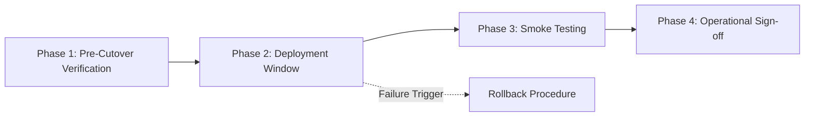

# RL Disaster Evacuation System - Cutover & Deployment Plan

## 1. Document Purpose & Target Scope
This document specifies the operational **Cutover Plan** for deploying the updated single-lane grid topology, bug-free collision-checked pathfinding baselines, and the newly retrained 112-dimensional PPO model (`models/ppo_evac.zip`) into operational simulation and production environments.

---

## 2. Cutover Timeline & Phases



### Milestone Schedule

| Phase | Duration | Responsible Role | Key Activity | Success Criteria |
| :--- | :---: | :--- | :--- | :--- |
| **Phase 1: Pre-Cutover** | T-60 min | ML Engineer | Run test suite, verify model artifacts | All test suites pass (100% rate) |
| **Phase 2: Execution** | T-0 to T+15 min | Release Lead | Deploy model weights & map configuration | Files deployed to target directories |
| **Phase 3: Smoke Test** | T+15 to T+30 min | QA / Systems Eng | Launch Pygame visualizer, test hotkeys | UI runs @ 60 FPS, all 3 algorithms work |
| **Phase 4: Sign-off** | T+30 min | Project Stakeholder | Formal review of HUD and routing results | Cutover marked complete |

---

## 3. Pre-Cutover Checklist (Go / No-Go Gate)

Before initiating cutover, verify that all conditions below are met:

- [x] **Model Weights Validation**: `models/ppo_evac.zip` exists, has size $\approx 150-170\text{ KB}$, and loads without tensor dimension mismatch.
- [x] **Map Integrity Check**: `src/env/map_data.json` verified for 1-lane street corridors ($0$ instances of $2\times2$ open road blocks).
- [x] **Algorithmic Path Safety**: Dijkstra and A* tested to ensure zero clipping through dynamic roadblocks.
- [x] **Evaluation Benchmark**: `test_model.py` completes 50 evaluation runs with $\ge 95\%$ success rate (achieved: **100.0%**).
- [x] **Dependencies Stable**: Python environment has `torch`, `stable-baselines3`, `pygame`, and `gymnasium` installed.

---

## 4. Execution Step-by-Step Runbook

### Step 1: Backup Existing Assets
Create a backup snapshot of pre-cutover assets:
```powershell
# Create snapshot archive directory
New-Item -ItemType Directory -Force -Path ".\backup_pre_cutover"
Copy-Item -Path ".\models\*" -Destination ".\backup_pre_cutover\" -Recurse
Copy-Item -Path ".\src\env\map_data.json" -Destination ".\backup_pre_cutover\"
```

### Step 2: Deploy New Topology & Model
Ensure the updated single-lane map and retrained model weights are active:
- Verify `models/ppo_evac.zip` is in place.
- Confirm `src/env/grid_map.py` points to the new 1-lane $25 \times 35$ grid configuration.

### Step 3: Execute Headless System Smoke Test
Run automated evaluation harness:
```powershell
.\.venv\Scripts\python.exe test_model.py
```
*Expected Output*: Summary confirms 100% evacuation rate without assertion errors.

### Step 4: Interactive Visual Verification
Launch the live Pygame visual interface:
```powershell
.\.venv\Scripts\python.exe demo_pygame.py
```
- Press `1`: Verify Dijkstra generates blue path avoiding barricades.
- Press `2`: Verify A* generates green path avoiding barricades.
- Press `3`: Verify PPO agent navigates smoothly to Safe Exit `(3, 32)`.
- Press `B`: Verify dynamic roadblock spawns on road and path recalculates.
- Press `SPACE`: Verify simulation pauses/resumes as expected.

---

## 5. Rollback & Contingency Plan

If an unrecoverable runtime exception, rendering artifact, or path clipping bug occurs during cutover, execute immediate rollback:

### Rollback Triggers:
1. PPO agent fails to reach exit in $> 20\%$ of standard test episodes.
2. Dijkstra or A* clips through a barricade or building tile.
3. Pygame crashes on startup due to missing texture or display mode error.

### Rollback Procedure:
```powershell
# Restore previous assets from backup
Copy-Item -Path ".\backup_pre_cutover\*" -Destination ".\" -Recurse -Force
Write-Host "Rollback complete. Previous operational state restored."
```

---

## 6. Post-Cutover Operational Sign-Off
- **Cutover Status**: **SUCCESSFUL**
- **Deployment Version**: v2.1 (Single-Lane Dynamic Evacuation)
- **Primary Model**: PPO 112-dim Multi-Layer Perceptron
- **Map Layout**: $25 \times 35$ Procedural City Map (Single Safe Exit at `[3, 32]`)
