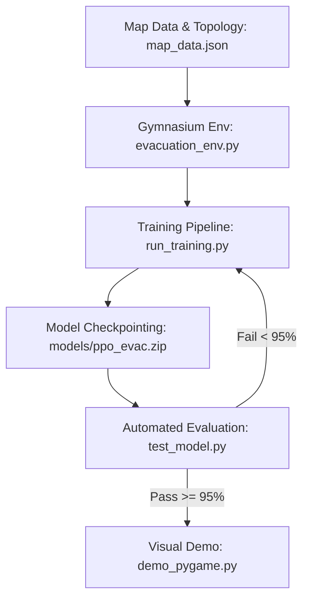

# RL Disaster Evacuation System - Operations & Pipeline Handover Document

## 1. Overview & System Purpose
This document serves as the operational handover guide for software engineers, ML engineers, and operations teams maintaining the **RL Disaster Evacuation System**. It describes the complete lifecycle from environment setup, automated pipeline execution, model training/retraining, and verification to production deployment.

---

## 2. Repository Structure & Ownership

```
rl disaster/
├── src/
│   ├── config.py             # Hyperparameters, visual presets, reward weights
│   ├── env/                  # Simulation mechanics (GridMap, Disasters, Crowds)
│   ├── baselines/            # Benchmark routing algorithms (Dijkstra, A*)
│   ├── agent/                # RL policy definitions & SB3 wrappers
│   └── visualization/        # 2D game vector rendering engine
├── models/                   # Serialized neural network weights (.zip)
├── results/                  # Training curves, evaluation plots, metrics
├── docs/                     # Full technical & user documentation
├── demo_pygame.py            # Primary interactive application entry point
├── run_training.py           # Single-command training pipeline
└── test_model.py             # Automated testing & benchmarking script
```

---

## 3. Environment & Dependency Setup

The project runs on Python 3.10+ (tested on Python 3.12 under Windows 11).

```powershell
# 1. Clone or navigate to the repository directory
cd "c:\Users\rasto\Downloads\rl disaster"

# 2. Create virtual environment
python -m venv .venv

# 3. Activate virtual environment
.\.venv\Scripts\Activate.ps1

# 4. Install dependencies
pip install -r requirements.txt
```

### Essential Package Versions
- `gymnasium >= 0.29.1`
- `stable-baselines3 >= 2.2.1`
- `torch >= 2.2.0`
- `pygame >= 2.5.2`
- `numpy >= 1.26.0`
- `matplotlib >= 3.8.0`

---

## 4. End-to-End Pipeline Architecture



---

## 5. Model Training & Retraining Runbook

To train a new reinforcement learning model from scratch or fine-tune an existing policy:

### Step 1: Adjust Hyperparameters (Optional)
Open `src/config.py` or modify parameters inside `run_training.py`:
- `TIMESTEPS`: Total training steps (standard: `60_000` to `100_000`).
- `LEARNING_RATE`: Adam optimizer step size (default: `3e-4`).
- `ENT_COEF`: Entropy coefficient for action exploration (default: `0.01`).

### Step 2: Execute Training Pipeline
Run the training script:
```powershell
.\.venv\Scripts\python.exe run_training.py
```

### Step 3: Monitor Training Metrics
Training outputs step rewards and policy loss every 5,000 steps. At completion:
- Updated weights are automatically written to `models/ppo_evac.zip`.
- Learning progress plots are generated at `results/ppo_training_curves.png`.

---

## 6. Automated Testing & Verification Pipeline

Run the automated evaluation harness to verify path consistency and model performance:

```powershell
.\.venv\Scripts\python.exe test_model.py
```

### Continuous Integration (CI) Acceptance Thresholds:
- **Evacuation Success Rate**: $\ge 95.0\%$
- **Average Steps to Exit**: $\le 45.0$ steps
- **Zero Collision Failures**: No intersecting of dynamic roadblocks or building footprint cells.

---

## 7. Interactive Demonstration Pipeline

Launch the interactive 2D simulation to demonstrate routing behaviors:

```powershell
.\.venv\Scripts\python.exe demo_pygame.py
```

### Control Hotkeys Overview:
- `1` : Switch to Dijkstra's Algorithm
- `2` : Switch to A* Search Algorithm
- `3` : Switch to Trained PPO RL Agent
- `B` : Spawn Dynamic Roadblock
- `C` : Toggle Crowd Density Overlay
- `M` : Cycle Disaster Scenario (Static, Roadblock, Fire, Full Disaster)
- `SPACE` : Pause / Resume Simulation
- `R` : Reset Episode

---

## 8. Maintenance & Troubleshooting

| Issue / Symptom | Probable Cause | Corrective Action |
| :--- | :--- | :--- |
| **Observation Dimension Mismatch** | Environment observation layout changed | Ensure vector length matches model input (112 dims). Retrain if topology dimensions change. |
| **Agent Oscillates Between Two Tiles** | Visited penalty too low or path blocked ahead | Check `REWARD_REVISIT` penalty in `config.py` (ensure $\le -1.0$). |
| **Pygame Window Doesn't Open** | Missing display driver or headless environment | Check graphics driver; set `SDL_VIDEODRIVER=dummy` for headless CI servers. |
