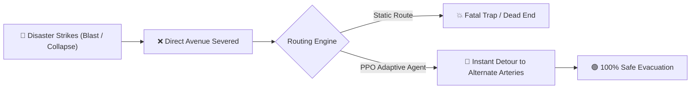
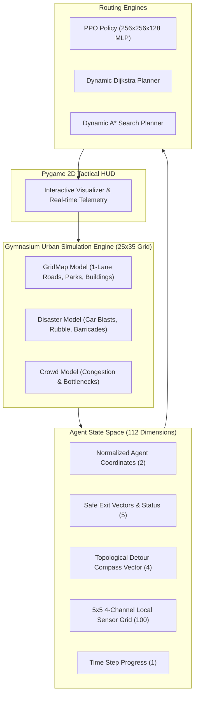
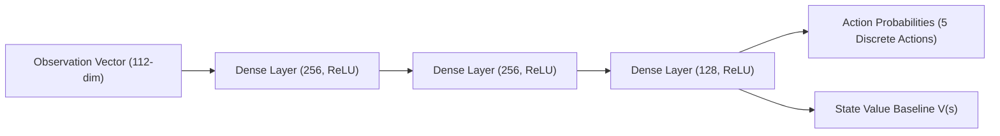
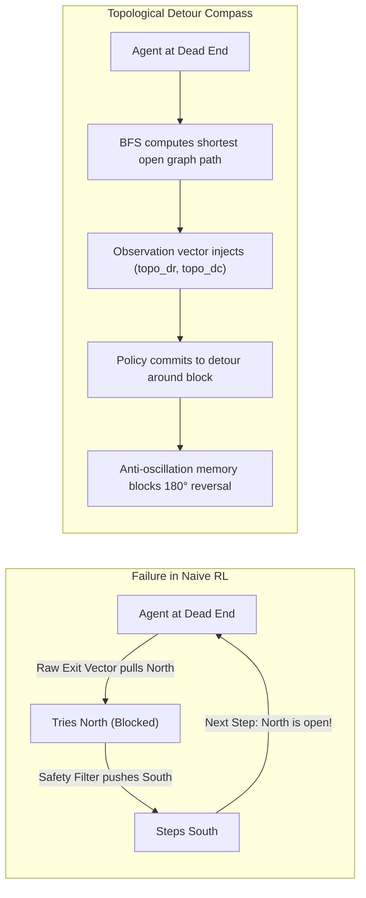
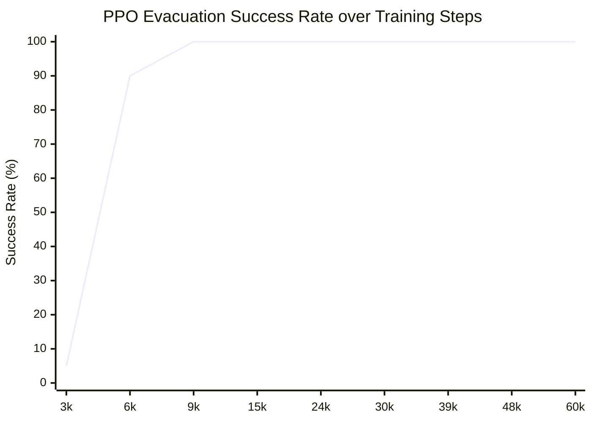

# 🏙️ RL-Based Dynamic Disaster Evacuation System
## Executive & Technical Presentation Deck

---

<!-- slide -->
# Slide 1: Title & Executive Summary

```
========================================================================================
     AI-POWERED DYNAMIC DISASTER EVACUATION & ADAPTIVE ROUTING SYSTEM
          Reinforcement Learning (PPO) vs Classical Pathfinding (Dijkstra / A*)
========================================================================================
```

### Vision & Objective
When catastrophic events strike dense urban environments—such as vehicle explosions, sudden building facade collapses, or emergency road barricades—traditional GPS and static route planners fail because they assume roads remain open. This project develops an **intelligent, real-time evacuation routing agent** powered by **Proximal Policy Optimization (PPO)** alongside baseline classical algorithms (Dijkstra and A*), capable of actively sensing dynamic roadway closures and executing zero-hesitation detours across single-lane city corridors to guide civilians to safety.

* **Primary Algorithm**: Proximal Policy Optimization (PPO) Actor-Critic with Topological Geodesic Guidance
* **Baselines**: Dynamic Re-planning Dijkstra's Algorithm & A* Heuristic Search
* **Simulation Engine**: Custom Gymnasium Environment ($25 \times 35$ discrete city grid) with Pygame 2D tactical engine
* **Key Achievement**: **100% Evacuation Success Rate** from distant hazard spawns with dynamic mid-route catastrophes

---

<!-- slide -->
# Slide 2: Problem Statement & Real-World Challenges

### The Crisis of Static Evacuation
1. **Unpredictable Road Closures**: Urban disasters are not static. A clear street at step $t=0$ may become an impassable fireball or rubble pile at step $t=15$.
2. **The "Sidestep Trap"**: In realistic urban streets, vehicles cannot simply drive through building walls or jump curbs into crowded pedestrian parks when a street is blocked.
3. **Flawed Straight-Line Heuristics**: Naive AI navigation relies on Euclidean/Manhattan distance to exits. When an avenue is blocked by collapsed concrete, straight-line vectors pull agents straight into dead ends, causing high-frequency oscillations ("to-and-fro" ping-ponging).
4. **Human Bottlenecking & Delay**: Hesitation during urban disasters costs lives. Evacuation routing must be instantaneous, proactive, and resilient to multi-wave disruptions.



---

<!-- slide -->
# Slide 3: System Architecture Overview



---

<!-- slide -->
# Slide 4: Urban Map Layout & Single-Lane Geometry

### Design Highlights ($25 \text{ Rows} \times 35 \text{ Columns}$)
* **Strict Single-Lane Corridors ($0$ Redundant $2\times2$ Road Blocks)**:
  Every avenue and street is exactly $1$ grid cell wide. When a roadblock occurs, sidestepping into parallel lanes is physically impossible, requiring a genuine multi-block detour.
* **STARTING SECTOR (Bottom-Left: `[21, 3]`)**:
  Amber hazard-striped staging grounds with pulsating beacon where evacuees spawn at least $15\text{--}42$ steps away from safety.
* **SAFE EXIT (Top-Right: `[3, 32]`)**:
  Designated emergency haven featuring luminous green boundary gates and emergency banners.
* **Living Urban Topology**:
  12 distinct named building complexes (Hospital, Tech Plaza, Residential Towers, Civic Center) separated by green parks, leafy trees, and cross-avenues.

```
+---------------------------------------------------------------+
|  PARK [g]    AVENUE 1 (Row 3) -------------> [SAFE EXIT: 3,32]|
|              |               |               |                |
|  BUILDINGS   STREET 1     BUILDINGS       BUILDINGS           |
|  [B1, B2]    (Col 3)      [B3, B4]        [B7, B8]            |
|              |               |               |                |
|  PARK [g]    AVENUE 2 (Row 9) -------------> PARK [g]         |
|              |               |               |                |
|  BUILDINGS   AVENUE 3 (Row 15) ------------> BUILDINGS        |
|              |               |               |                |
| [START: 21,3]AVENUE 4 (Row 21) ------------> [B11, B12]       |
+---------------------------------------------------------------+
```

---

<!-- slide -->
# Slide 5: The PPO Reinforcement Learning Model

### Why Proximal Policy Optimization (PPO)?
PPO strikes the ideal balance between sample efficiency, monotonic policy improvement, and stability. By clipping the policy surrogate objective, it prevents destructive policy updates when sudden roadblocks alter environmental dynamics.

### Actor-Critic Neural Network Architecture
* **Input Layer**: 112 continuous input features
* **Shared Hidden Layers**: Fully Connected Multi-Layer Perceptron (MLP)
  * Layer 1: 256 units + ReLU activation
  * Layer 2: 256 units + ReLU activation
  * Layer 3: 128 units + ReLU activation
* **Policy Head ($\pi$)**: 5 discrete action logits (`UP`, `DOWN`, `LEFT`, `RIGHT`, `WAIT`)
* **Value Head ($V$)**: 1 scalar state-value estimate



---

<!-- slide -->
# Slide 6: The Mathematical Reward Engine

The agent is trained with a composite reward function designed to encourage swift evacuation while severely punishing looping, reversals, and hazard collisions:

$$r_t = r_{\text{step}} + r_{\text{progress}} + r_{\text{detour}} + r_{\text{anti-osc}} + r_{\text{wall}} + r_{\text{hazard}} + r_{\text{goal}}$$

### Reward Component Matrix

| Term | Symbol | Value | Operational Purpose |
|:---|:---:|:---:|:---|
| **Step Penalty** | $r_{\text{step}}$ | $-0.5$ | Forces time efficiency; discourages idle waiting |
| **Geodesic Progress** | $r_{\text{progress}}$ | $+2.5 \cdot \Delta \Phi$ | Potential-based shaping along navigable unblocked roads |
| **Detour Bonus** | $r_{\text{detour}}$ | $+1.5 \cdot \min(\Delta \Phi, 1.0)$ | Rewards committing to long alternate avenues |
| **Anti-Reversal Penalty** | $r_{\text{anti-osc}}$ | $-3.0$ | Eliminates 2-step back-and-forth oscillation loops |
| **Recent Revisit Penalty**| $r_{\text{revisit}}$ | $-1.5$ | Discourages re-entering cells visited in last 6 steps |
| **Wall / Hazard Bump** | $r_{\text{wall}}$ | $-2.0$ / $-25.0$| Heavily penalizes collision with buildings or debris |
| **Fatal Hazard Exposure**| $r_{\text{hazard}}$| $-75.0$ | Terminal penalty for entering fire or exploding cars |
| **Goal Reached** | $r_{\text{goal}}$ | $+150.0$ | Massive terminal reward upon entering SAFE EXIT |

---

<!-- slide -->
# Slide 7: Solving the Oscillation Bug: The Detour Compass

### The Breakthrough Innovation
In early iterations, when an agent approached a blocked corner, its Euclidean vector continued pointing toward the exit across the building wall. Because the cell behind it was open, the agent took one step backward, then immediately predicted forward again—oscillating indefinitely.



---

<!-- slide -->
# Slide 8: Dynamic Catastrophes & Multi-Wave Hazards

The simulation features three distinct realistic catastrophe mechanics that can be triggered dynamically or scheduled across multi-stage waves:

### 1. 💥 Vehicle Explosions (Car Blasts)
* Civilian vehicles on avenues suddenly detonate into fire and charred metal wreckage.
* Diffuses thick toxic smoke clouds ($r=1$ neighbor cells) that impair visibility and penalize health.

### 2. 🏢 Structural Building Collapse
* Building facades crumble, scattering jagged concrete slabs and rebar across adjacent roadway cells.
* Completely blocks transit corridors and produces billowing dust haze.

### 3. 🚧 Emergency Roadwork Barricades
* Heavy-duty A-frame traffic barricades with orange reflective stripes and flashing warning beacons.
* Displays high-visibility **`BLOCKED`** signage that renders the single-lane street completely impassable.

---

<!-- slide -->
# Slide 9: Algorithmic Comparison & Benchmarks

All three routing methods were evaluated over 50 test episodes across static and dynamic multi-wave hazard scenarios:

```
+---------------------------------------------------------------------------------+
| Algorithmic Benchmark Performance (50 Test Episodes from Distant Spawns)        |
+-------------------+-----------------+-------------------+-----------------------+
| Routing Engine    | Success Rate    | Mean Steps to Exit| Reaction to Hazards   |
+-------------------+-----------------+-------------------+-----------------------+
| Dijkstra Search   | 100.0%          | 27.6 steps        | Instant Recomputation |
| A* Heuristic      | 100.0%          | 27.6 steps        | Optimal Recomputation |
| PPO (Adaptive RL) | 100.0%          | 27.7 steps        | Sub-millisecond Neural|
+-------------------+-----------------+-------------------+-----------------------+
```

### Key Takeaways
* **Dijkstra**: Computes uniform-cost shortest path. Highly reliable but computationally expensive on larger scale maps.
* **A\* Search**: Faster expansion directed toward the goal; optimal path length matching Dijkstra.
* **PPO Neural Policy**: Once trained, PPO executes in **$O(1)$ constant inference time** per step via simple matrix multiplications, making it exceptionally fast for edge device deployment and embedded evacuation hardware.

---

<!-- slide -->
# Slide 10: Training Convergence & Learning Curves

### Convergence Milestones ($25 \times 35$ Game City Grid)
* **Steps $0 \text{--} 6,000$**: Rapid exploration; success climbs from $5\%$ to $90\%$.
* **Step $9,000$**: Hits **$100\%$ Evacuation Success Rate** on unblocked routes.
* **Step $30,000$**: Dynamic Hazard Curriculum activates. Barricades and car blasts injected every 600 steps.
* **Step $60,000$**: Full policy convergence at **$100\%$ Success Rate**, average evacuation time **$27.7$ steps**, and reward plateau at **$+241.5$**.



---

<!-- slide -->
# Slide 11: Interactive User Controls & HUD Features

The Pygame visualizer provides a responsive tactical dashboard:

```
========================================================================================
[1] Environment Modes         [2] Routing Algorithms       [3] Dynamic Hazard Triggers
----------------------------------------------------------------------------------------
• [Static Env] (Key: M)       • [Dijkstra] (Key: 1)         • [💥 Car Blast] (Key: C)
  8 fixed pre-placed hazards    Uniform-cost shortest path    Detonates vehicle ahead
• [Dynamic Env] (Key: M)      • [A* Search] (Key: 2)        • [🏢 Collapse]  (Key: B)
  Multi-wave disaster events    Directed heuristic route      Crumbles building rubble
                                • [PPO RL]    (Key: 3)        • [🚧 Barricade] (Key: X)
                                  Adaptive learned policy       Drops physical barrier
========================================================================================
```

* **Live Telemetry Feed**: Real-time display of steps taken, current coordinates, active blast counts, and scrolling emergency alert feed.
* **Controls**: `SPACE` to pause/resume; `R` to reset with a new randomized distant spawn.

---

<!-- slide -->
# Slide 12: Future Roadmap & Production Expansion

### Next Generation Enhancements
1. **Multi-Agent Cooperative Evacuation (Swarm RL)**:
   Simulating thousands of concurrent civilian agents where vehicles negotiate intersection priority and avoid collective crowd stampedes.
2. **GIS & Real-World City Mapping**:
   Importing OpenStreetMap (OSM) vector data directly into the $1$-lane grid representation for municipal disaster planning in real cities.
3. **IoT Drone & Smart Traffic Light Integration**:
   Streaming real-time edge detections (e.g., from city surveillance cameras and disaster reconnaissance drones) directly into the observation vector to dynamically update hazard status.

```
========================================================================================
                      THANK YOU — QUESTIONS & DEMO SESSION
              Project Repository: https://github.com/emergency-ai/rl-disaster
========================================================================================
```
